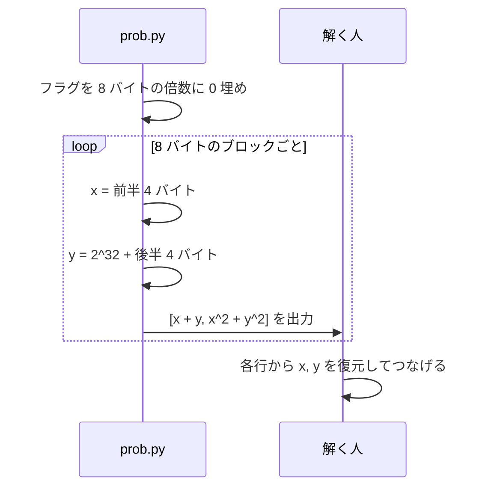
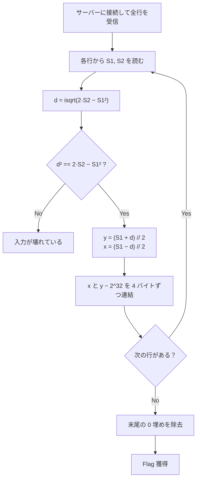

> [!IMPORTANT]
> **Solved with Gemini in Colab**
>
> この問題は Google の AI コーディングアシスタント **Gemini in Colab** を活用して解決されました。

> [!NOTE]
> この Writeup は AI により自動生成されています。 本ドキュメントは、AI アシスタントを用いて作成された Writeup です。記載内容は解法の一例であり、内容の正確性については十分にご確認の上ご利用ください。

# Σecret

## 概要
*   **カテゴリー**: Crypto
*   **トピック**: べき和・連立方程式
*   **難易度**: Easy 🌱
*   **問題リンク**: [Σecret - Daily AlpacaHack](https://alpacahack.com/daily/challenges/sigma-secret)

## 使用ツール
*   **Python 3**: 解法スクリプトの実装
*   **math**: `math.isqrt` による整数平方根の計算（Python 標準ライブラリ）
*   **socket / ast**: サーバーからの出力の受信とリストの読み取り（Python 標準ライブラリ）
*   **Gemini in Colab**: 配布ファイルの解析およびコード生成

## 問題の分析
本問題は、**Daily AlpacaHack** の Crypto 問題です。配布ファイルは次の 3 つです。

| ファイル | 内容 |
| :--- | :--- |
| `prob.py` | フラグからべき和を計算して出力するスクリプト |
| `Dockerfile` | `prob.py` を `socat` で TCP 公開するコンテナ定義 |
| `compose.yaml` | 環境変数 `FLAG` を渡してコンテナを起動する設定 |

`prob.py` の中身は次の通りです。

```python
from os import getenv


FLAG = getenv("FLAG", "Alpaca{REDACTED}").encode()
HALF_SIZE = 4
BLOCK_SIZE = 2 * HALF_SIZE
OFFSET = 1 << (8 * HALF_SIZE)

flag = FLAG + bytes(-len(FLAG) % BLOCK_SIZE)

for i in range(0, len(flag), BLOCK_SIZE):
    block = flag[i : i + BLOCK_SIZE]
    x = int.from_bytes(block[:HALF_SIZE], "big")
    y = OFFSET + int.from_bytes(block[HALF_SIZE:], "big")

    print([sum(v**k for v in (x, y)) for k in range(1, 3)])
```

フラグを 0 埋めで 8 バイトの倍数にそろえ、8 バイトごとのブロックを前半・後半の 4 バイトに分けて 2 つの整数 $`x, y`$ を作ります。出力されるのは、その **べき和（1 乗の和と 2 乗の和）** だけです。問題名の「Σ」は、この $`\sum`$（総和）を指しています。

| 変数 | 意味 | 範囲 | 公開されているか |
| :--- | :--- | :--- | :---: |
| $`x`$ | ブロック前半 4 バイトを big-endian で読んだ整数 | $`0 \le x < 2^{32}`$ | ❌ |
| $`y`$ | $`2^{32}`$ + ブロック後半 4 バイトの整数 | $`2^{32} \le y < 2^{33}`$ | ❌ |
| $`S_1`$ | $`x + y`$ | — | ✅ |
| $`S_2`$ | $`x^2 + y^2`$ | — | ✅ |



## 脆弱性の詳細

### 未知数 2 つに式が 2 つ
1 ブロックあたり未知数は $`x, y`$ の 2 つで、与えられる式も $`S_1, S_2`$ の 2 つです。しかも 1 乗と 2 乗の和は **基本対称式** $`x + y`$ と $`xy`$ に書き直せるので、2 次方程式を解くだけで $`x, y`$ が決まります。秘密にしたいはずの値を、可逆な式でそのまま出力してしまっているのが本問の弱点です。

### $`(y - x)^2`$ を作る
2 乗の和と和の 2 乗を組み合わせると、交差項 $`2xy`$ が打ち消し合います。

```math
\begin{aligned}
2 S_2 - S_1^2 &= 2(x^2 + y^2) - (x + y)^2 \\
&= 2x^2 + 2y^2 - x^2 - 2xy - y^2 \\
&= x^2 - 2xy + y^2 \\
&= (y - x)^2
\end{aligned}
```

右辺は完全平方数なので、整数平方根 `math.isqrt` で誤差なく $`d = |y - x|`$ が求まります。

### 符号は OFFSET が決めてくれる
平方根からは $`|y - x|`$ しか分からず、普通は $`x`$ と $`y`$ のどちらが大きいかが曖昧になります。ところが `prob.py` は $`y`$ にだけ $`2^{32}`$（`OFFSET`）を足しているので、

```math
x < 2^{32} \le y \quad \Longrightarrow \quad d = y - x > 0
```

と順序が確定します。あとは和と差から連立方程式を解くだけです。

```math
\begin{aligned}
y &= \frac{S_1 + d}{2} \\
x &= \frac{S_1 - d}{2}
\end{aligned}
```

最後に $`y`$ から $`2^{32}`$ を引き、$`x`$ と $`y - 2^{32}`$ をそれぞれ 4 バイトの big-endian に戻してつなげれば、元の 8 バイトのブロックになります。全ブロックを連結し、末尾の 0 埋めを取り除けばフラグです。

> [!TIP]
> $`S_1`$ と $`d`$ は $`x + y`$ と $`y - x`$ なので偶奇が必ず一致し、$`(S_1 \pm d) / 2`$ は常に割り切れます。Python では `//` を使えば整数のまま計算できます。

### 補足
$`d`$ を使わずに、2 次方程式として解くこともできます。基本対称式 $`e_1 = x + y`$、$`e_2 = xy`$ を使うと

```math
\begin{aligned}
e_1 &= S_1 \\
e_2 &= \frac{S_1^2 - S_2}{2}
\end{aligned}
```

となり、$`x, y`$ は $`t`$ の 2 次方程式の 2 つの解です。

$$
t^2 - e_1 t + e_2 = 0 \quad \Longrightarrow \quad t = \frac{e_1 \pm \sqrt{e_1^2 - 4 e_2}}{2}
$$

判別式は $`e_1^2 - 4e_2 = S_1^2 - 2(S_1^2 - S_2) = 2S_2 - S_1^2 = (y - x)^2`$ となり、本文の方法と同じ式に行き着きます。

<details>
<summary>🔎 補足: もっと大きなべき和でも同じことができる？（クリックで展開）</summary>

一般に、変数が n 個あれば、1 乗から n 乗までのべき和が分かると **ニュートンの恒等式** で基本対称式がすべて求まり、n 次方程式の解として元の値の組が復元できます。本問は n = 2 なので、2 次方程式で済む一番簡単なケースです。

ただし復元できるのは「値の組」までで、どれがどの変数かは分かりません。本問では OFFSET による大小関係が、その並び順を教えてくれる役割を果たしています。

</details>

### 攻撃フロー


> [!WARNING]
> 和や 2 乗和のような「集計値」でも、元データの個数が少なければ元の値が完全に復元できます。秘密の値を隠したいなら、可逆な代数式ではなく、鍵を使った暗号やハッシュなどを使う必要があります。

## 用語解説
*   **べき和（power sum）**: $`x^k + y^k`$ のように、各変数の k 乗を足し合わせた値です。本問では k = 1, 2 が出力されます。
*   **基本対称式**: 変数を入れ替えても値が変わらない多項式の基本形です。2 変数なら $`x + y`$ と $`xy`$ の 2 つです。
*   **ニュートンの恒等式**: べき和と基本対称式を結ぶ関係式です。これを使うとべき和から基本対称式を順に求められます。
*   **整数平方根（`math.isqrt`）**: $`\lfloor \sqrt{n} \rfloor`$ を整数のまま正確に求める Python 3.8 以降の関数です。浮動小数点の誤差が出ないので巨大な整数でも安全です。
*   **big-endian**: バイト列の先頭を上位の桁として整数に読む方式です。`int.from_bytes(b, "big")` と `int.to_bytes(n, 4, "big")` が対応します。
*   **パディング**: 長さをブロックの倍数にそろえるために足す詰め物です。本問では `bytes(...)` による `0x00` が末尾に足されます。

## 解決スクリプト
[solve.py を参照してください](./solve.py)

```bash
python3 solve.py <HOST> <PORT>
```

接続先の HOST と PORT は、問題ページでインスタンスを起動して確認してください。配布ファイル（`sigma-secret.tar.gz`）を展開した手元の `prob.py` で動作を試すこともできます。

```bash
FLAG='Alpaca{dummy_flag}' python3 ./sigma-secret/prob.py | python3 solve.py
```
